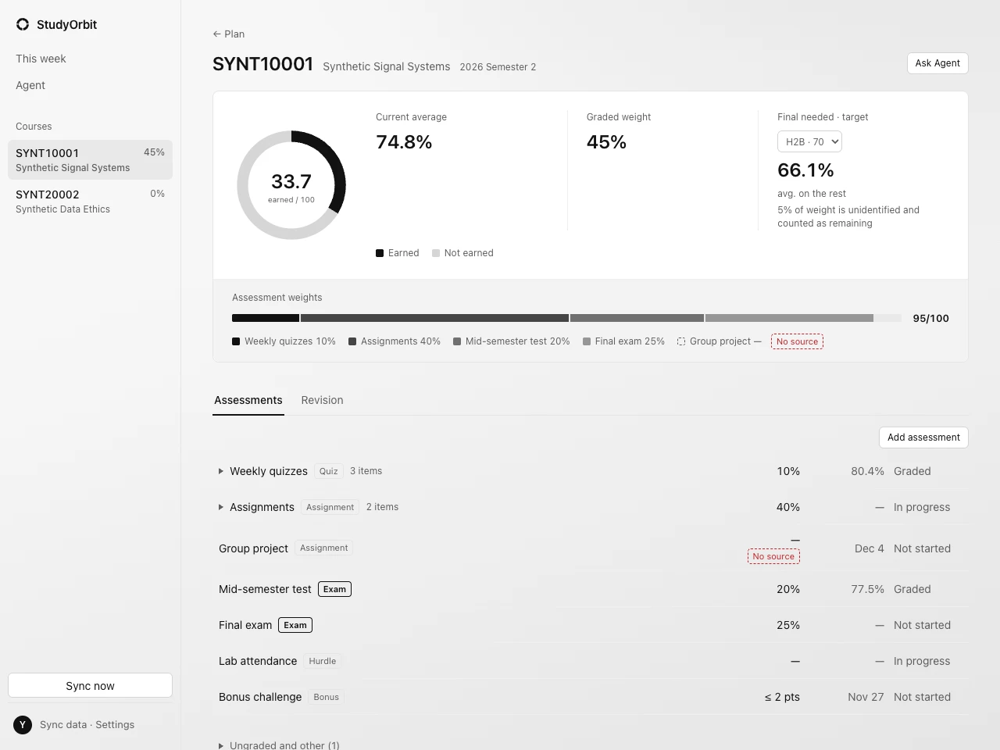
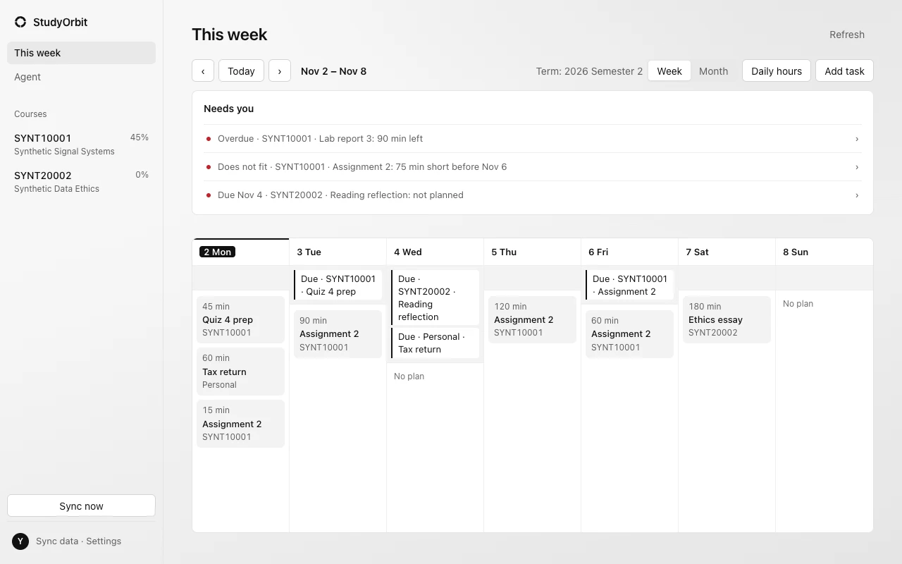
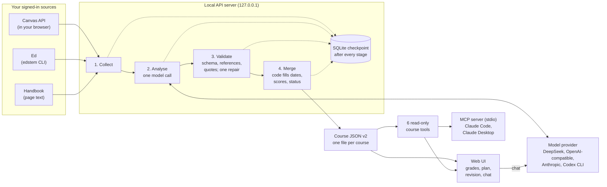

# StudyOrbit

**A local-first coursework assistant for University of Melbourne students:** it reads your courses from the Canvas, Ed and Handbook sessions you are already signed in to, turns them into one validated course file per course, and shows your grades, what you still need, a weekly plan and a chat that can answer questions about them.

[](https://github.com/MortyYJT/studyorbit/actions/workflows/ci.yml)
[](LICENSE)
[](package.json)



<sub>All screenshots use made-up data (the synthetic course `SYNT10001` from `test/fixtures/`).</sub>

## What it does

- **Sync your courses.** Tick the Canvas courses you want; StudyOrbit collects Canvas, Ed and the Handbook, and a model of your choice organises them into one course file per course. Code checks every file before it is saved.
- **See where you stand.** Marks earned, current average, how much of the course is already marked, and each item's weight. Pick a target band (H1 to P) to see the average you need on what is left, or whether it is already secured or out of reach.
- **Fix what the sync got wrong.** Correct, merge, add or hide assessments. Corrections are stored separately, survive the next sync, and when a sync and your correction disagree you choose which value to keep.
- **Plan the week.** Set the hours you have each day and tasks are spread over the days before their deadlines, earliest deadline first. Work that does not fit, overdue work, unplanned deadlines and deadlines or weights that changed in a sync are listed under "Needs you".
- **Revise and ask.** The revision tab lists exam dates, weights and rules. The chat answers from your synced data; with DeepSeek, OpenAI-compatible APIs and Anthropic it computes grades through tools that run the same code as the course page. It explains and plans; it never writes, completes or submits any assessment.
- **Use it from other AI clients.** A local MCP server exposes the same read-only course tools to Claude Code, Claude Desktop and other MCP clients.
- **Choose the model.** DeepSeek, any OpenAI-compatible API (including a local Ollama), Anthropic Claude or the Codex CLI.

The interface defaults to Chinese; an English version can be chosen under Settings → Language.



## How it works



- **Code collects, the model only judges.** Collectors read Canvas through same-origin API calls in the browser you are signed in to, Ed through the `edstem` CLI and the Handbook as page text. The model receives only the collected data and returns judgements: grouping, kind, weights and rules, each with the platform items it rests on. Deadlines, scores and status are filled in by code from platform data, never by the model ([course JSON contract](docs/course-json.md)).
- **Validated before it is saved.** Local validation checks the course identity, that every reference exists in the collected data and the parent–child rules. On failure the output and the errors go back to the model for one repair. Weights and rules whose quote cannot be found in the collected data are cleared and flagged "no source".
- **Resumable.** Each course goes through collect → analyse → validate → merge, with a checkpoint in `node:sqlite` after each stage. A failed, cancelled or interrupted sync can be resumed within 24 hours; finished stages are not collected or analysed again.
- **Local by default.** The API binds to `127.0.0.1` and accepts only same-origin requests that carry a per-launch token added by the page server's proxy ([overview](docs/overview.md#processes-ports-and-token)).

## Engineering highlights

Measured on one student's four courses unless stated otherwise. Each number links to the document with its method and limits.

- **Sync from 21 minutes to about 2 minutes.** A full sync of four courses took 21 min with the original design (33 agent jobs reading pages) and **116.5 s** with code collection plus one structured model call per course, about 10.8× faster; model input fell from 8,817,416 to **44,269 tokens** (about 199× fewer than the first v2 version). One run per stage, and the 21-minute baseline did not read Canvas for any course, so it did not produce complete data: the comparison is about finishing a sync, not getting the same data ([sync optimisation](docs/sync-optimization.md)).
- **More consistent course analysis.** Moving to contract v2 (the model gives judgements with references, code fills in facts) raised cell consistency across five repeated runs from **55.6% to 84.5%**. This compares runs with each other, not with ground truth: the reference answers are an earlier, unverified model output ([course analysis evaluation](docs/eval-course-analysis.md)).
- **Chat numbers computed by tools.** On 32 synthetic questions run 5 times each, answers with the course tools were right in **160/160** chats against **125/160** when the whole course data was put in the prompt. Most of the difference is data the old mode did not have and definitions that now match the course page, not arithmetic; tool mode used about 7.3× the input tokens. One model (`deepseek-flash`) only ([chat Q&A evaluation](docs/eval-chat-qa.md)).
- **Resume without redoing work.** With a fake model and synthetic courses, a sync crashed at each stage boundary and resumed produced byte-identical results to an uninterrupted run, with no finished collection or model call repeated. Resume has not yet been exercised in a real sync ([resume versus restart](docs/sync-optimization.md#resume-versus-restart-fake-model-synthetic-data)).
- **Tested on synthetic data only.** Grades, the final-needed target and the weekly plan are pure functions; `npm run check` (type check plus vitest, the same as CI) uses synthetic fixtures and never touches real course data.

## Tech stack

| Layer | Choice |
| --- | --- |
| Runtime | Node.js 24 (`node:sqlite`, `node:http`), TypeScript |
| Web | React 19, Vite 8, no UI framework |
| Contracts | zod schemas shared by the server, the page and the tools (`shared/`) |
| Storage | `node:sqlite` for sync jobs and checkpoints; JSON files for course data, corrections and settings |
| Collection | Canvas REST API through the signed-in browser (Apple Events on macOS, a dedicated browser over the DevTools pipe elsewhere), the `edstem` CLI |
| Models | DeepSeek, OpenAI-compatible APIs, Anthropic, Codex CLI |
| Integration | MCP over stdio (`@modelcontextprotocol/sdk`) |
| Tests | vitest, GitHub Actions |

## Quick start

Requires Node.js 24.15 or later.

```bash
npm ci
npm run dev
```

Open `http://localhost:5173/`. To sync real courses you also need Microsoft Edge on macOS signed in to Canvas, the [`edstem` CLI](https://github.com/bunizao/edstem-cli) signed in to Ed, and a model key in Settings → Analysis model. Other browsers, other operating systems, other institutions' Canvas, ports and environment variables are covered in **[docs/setup.md](docs/setup.md)**.

> Saving the course selection starts a sync at once, which uses your browser, Ed and model credit. Check the result of a sync by hand; do not treat it as correct by default.

## Try it without a UniMelb account

The repository ships a synthetic course (`test/fixtures/synthetic-course/`, course code `SYNT10001`, all data made up). Without signing in or a model key you can run the whole path "model output → local validation → rejection and repair → scoring against a reference answer":

```bash
node scripts/eval-course-analysis.mjs --fixture test/fixtures/synthetic-course
```

The first fixed output cites a Canvas assignment that does not exist, so validation rejects it and triggers one repair; a later one passes validation but misses a hurdle and has a wrong type, which only the comparison with the reference answer catches. The terminal prints accuracy, consistency and rejection counts (in Chinese); full results go to `.local/eval/results/`. Add `--live` to call your configured model instead. Details are in [course analysis evaluation](docs/eval-course-analysis.md#running-it).

`npm run check` runs every test, all on synthetic data.

## Use from an MCP client

`scripts/mcp-server.mjs` is a local stdio MCP server (name `studyorbit`) with the same 6 read-only tools as the chat: `list_courses`, `get_assessments`, `calculate_grades`, `final_needed`, `upcoming_deadlines`, `plan_schedule`. Given the same data and arguments it returns the same results as the chat in the page.

Replace `<repo>` with the absolute path of this repository. The `node` your client starts must be 24 or later; if a client (especially Claude Desktop) does not find the right one, use the absolute path from `which node`.

**Claude Code:**

```bash
claude mcp add studyorbit -- node <repo>/scripts/mcp-server.mjs
```

**Claude Desktop:** edit `claude_desktop_config.json` (on macOS in `~/Library/Application Support/Claude/`, or via Settings → Developer → Edit Config), add the server and restart Claude Desktop:

```json
{
  "mcpServers": {
    "studyorbit": {
      "command": "node",
      "args": ["<repo>/scripts/mcp-server.mjs"]
    }
  }
}
```

**Other clients:** a stdio server with command `node` and arguments `["<repo>/scripts/mcp-server.mjs"]`. No key or environment variable is needed. Start it with `node`, not `npm run mcp`: npm prints a header line on standard output, which breaks the protocol.

| Argument | Effect |
| --- | --- |
| `--courses <id,id>` or `STUDYORBIT_COURSES` | Expose only these Canvas course IDs (`--courses` wins; call `list_courses` without a filter to see them) |
| `--project <dir>` | Which project's `.local/` to read; defaults to this repository |
| `--desktop <dir>` | Where the course folders are; defaults to `~/Desktop`, like the page |

For example, `claude mcp add --env STUDYORBIT_COURSES=<id>,<id> studyorbit -- node <repo>/scripts/mcp-server.mjs`, or `"env": { "STUDYORBIT_COURSES": "<id>,<id>" }` in the Claude Desktop entry.

- **Read-only and local:** every call re-reads the course list and the newest valid course files, so no restart is needed after a sync. The server does not sync, write files, call a model, read model settings or keys, or use the network. It does not apply corrections made in the page.
- **No planning data:** weekly-plan tasks live in the browser; `plan_schedule` works only with tasks passed in as arguments, as the chat does.
- **Where data goes:** tool results contain your grades and assessments and are sent to the model your client uses (Claude Code and Claude Desktop send them to Anthropic), under that provider's terms. Use `--courses` to keep a course out. Diagnostics go to standard error only and contain no course content.

## Privacy and data

| What | Where |
| --- | --- |
| Collected snapshots, sync records and checkpoints, change log, corrections, model and data-source settings, chats, revision notes | `.local/` in the project, ignored by Git; settings files have mode 600 and keys are write-only |
| Each course's course JSON | A per-semester course folder on your Desktop ([exact paths](docs/overview.md#where-data-lives)) |
| Course selection, tasks and time spent, daily hours, appearance, background image | Browser localStorage and IndexedDB; the background image is never uploaded |

- **Storage stays on your machine.** During analysis and chat, course data, including grades, is sent to the model provider you chose, under that provider's terms, and model calls may cost money. With a local model (for example Ollama) the data stays on your machine.
- **Only this page can reach the local API.** It accepts same-machine, same-origin requests carrying the per-launch token; other websites, other local ports and other devices on your network cannot read your data.
- **No passwords, no personal Canvas token.** You sign in and complete multi-factor authentication yourself; collectors never read cookies or passwords, and the model never sees them.

## Platform support

Only **macOS + Microsoft Edge + University of Melbourne** (Canvas, Ed Australia, Handbook) has been run for real. Google Chrome on macOS, other institutions' Canvas, the Ed US and EU regions, and the dedicated browser for Windows and Linux are implemented and covered by tests with synthetic data, but have not been run on real setups yet ([setup](docs/setup.md#data-sources)).

## Documentation

| Document | Contents |
| --- | --- |
| [Setup](docs/setup.md) | Requirements, browsers and platforms, other institutions, the `edstem` CLI, models, environment variables |
| [Overview](docs/overview.md) | Processes, data flow, what is collected, code map, every script, where data lives |
| [Course JSON](docs/course-json.md) | The v2 contract: what the model fills in, what code fills in, validation and quote checks |
| [Sync optimisation](docs/sync-optimization.md) | Measured time and tokens of real syncs, resume versus restart, raw records |
| [Course analysis evaluation](docs/eval-course-analysis.md) | Method and results of the repeated-run evaluation |
| [Chat Q&A evaluation](docs/eval-chat-qa.md) | Context mode versus tool mode on a synthetic question set |

Requirements live in `openspec/specs/`. Working rules are in [CLAUDE.md](CLAUDE.md); the handoff, decisions and product notes in `note/` are written in Chinese.

## Licence

[MIT](LICENSE) © 2026 MortyYJT. Dependencies keep their own licences; the external `edstem` CLI is not distributed with this repository.
